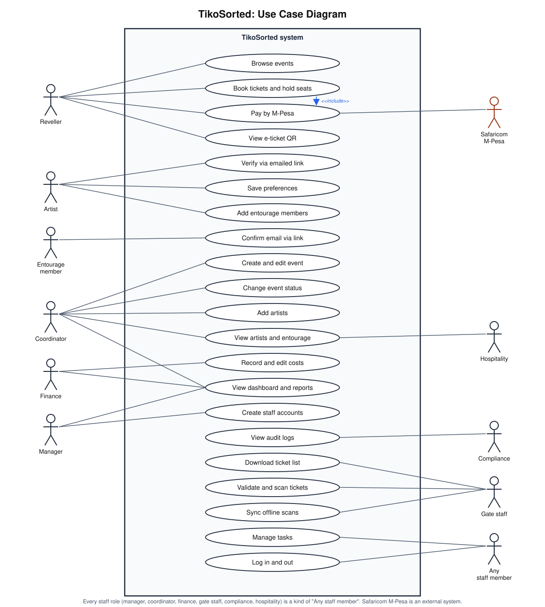
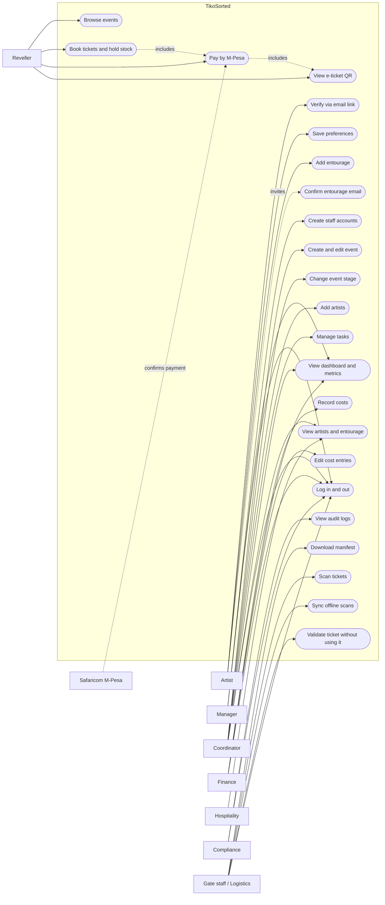
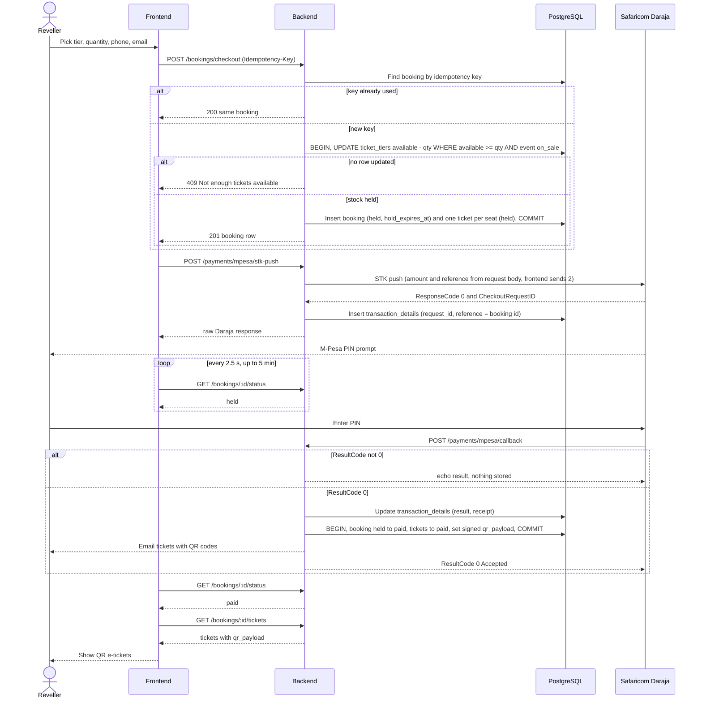
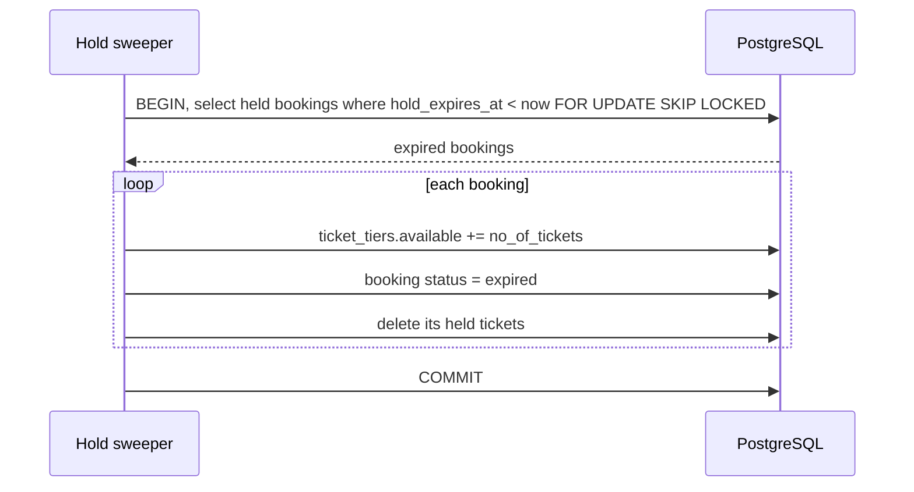
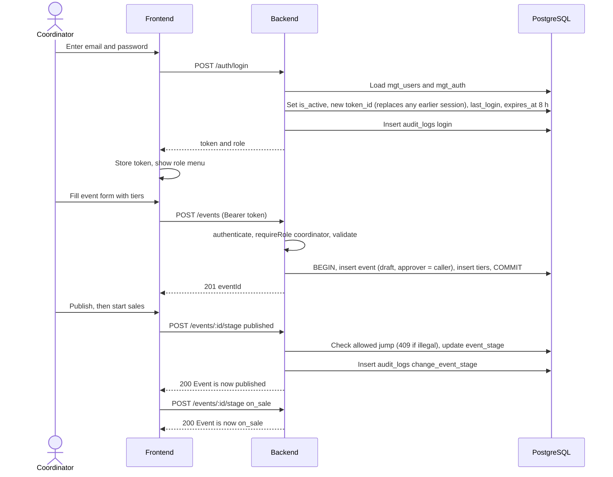
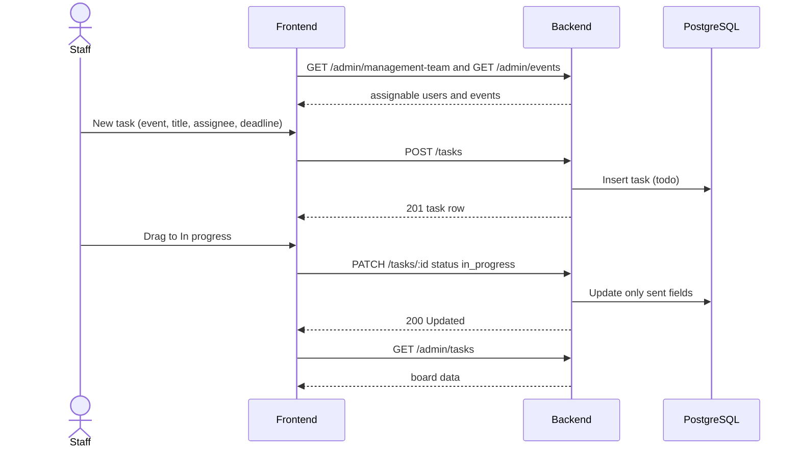
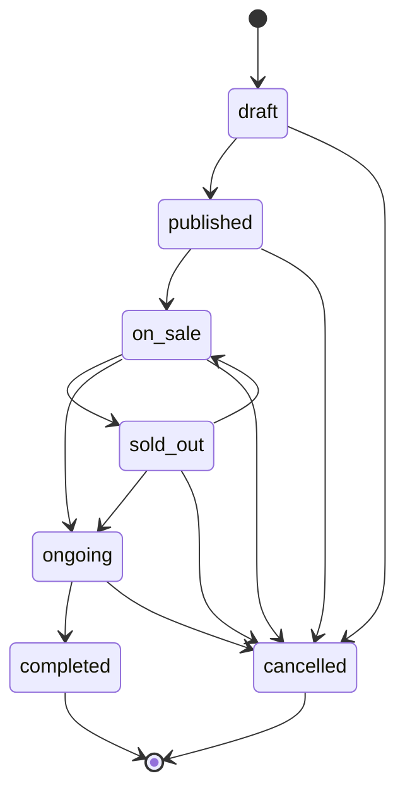
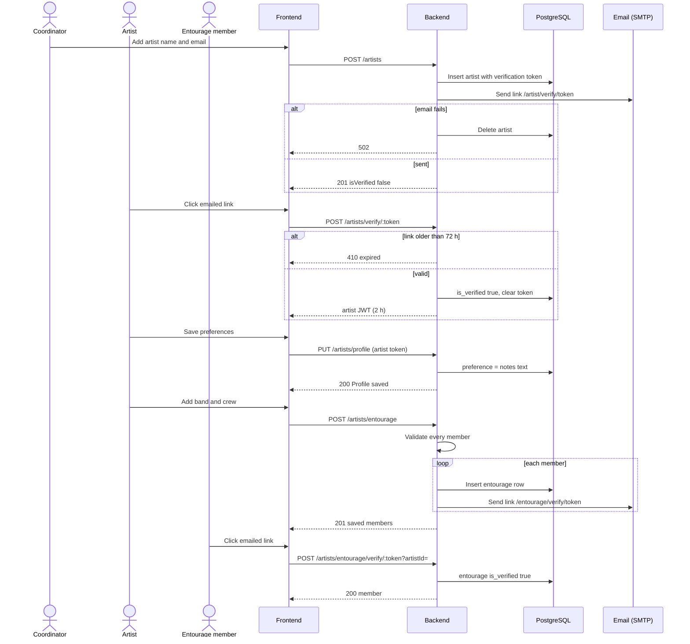
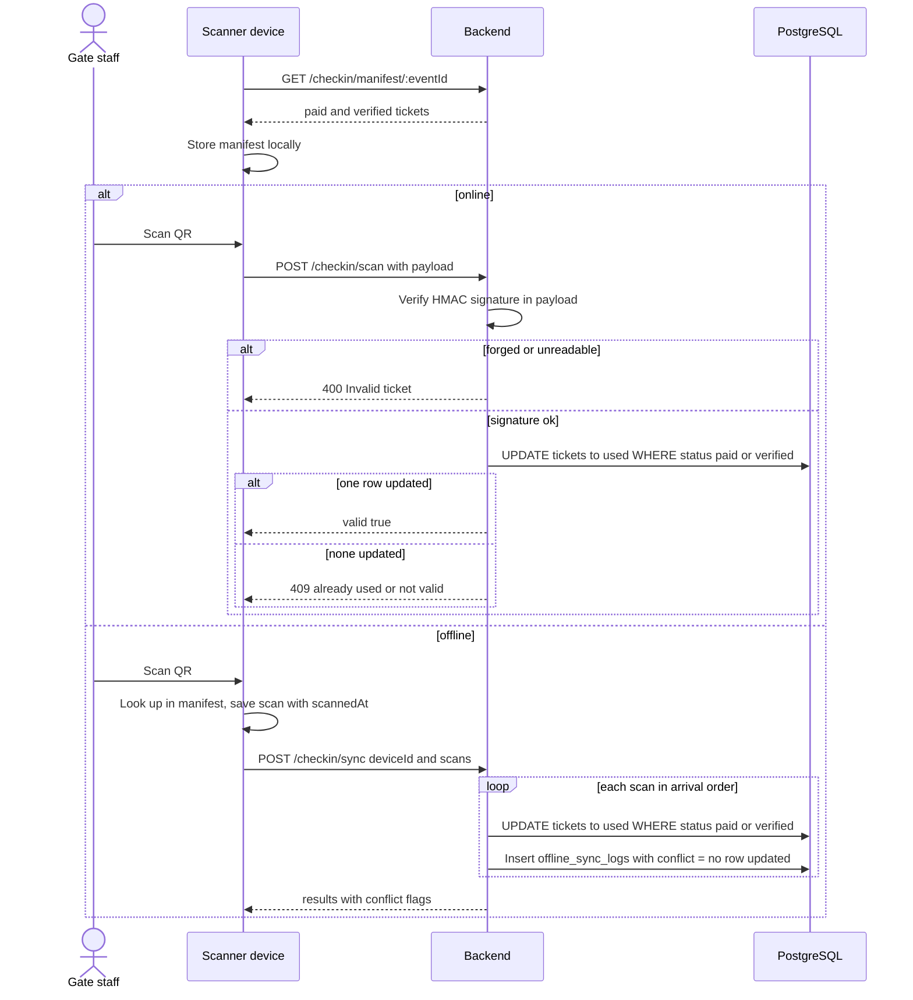
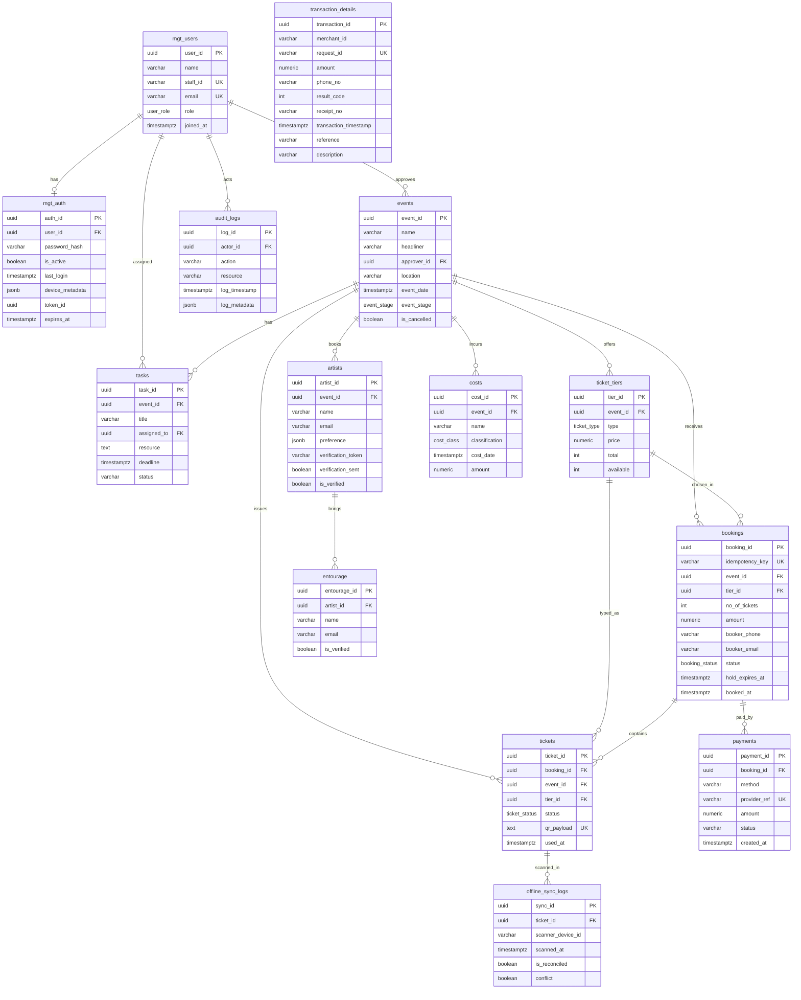

# Diagrams

All diagrams are Mermaid, so they render directly on GitHub. The ERD source is also in [schema.dbml](schema.dbml) for dbdiagram.io.

## 1. Use case diagram

Actors (stick figures) sit outside the system boundary. Each use case is an oval inside the system rectangle. The dashed arrow means "Book tickets" includes "Pay by M-Pesa".

PNG copy: [usecase.png](usecase.png). The Mermaid version below draws the same model if you prefer to edit it as text (ovals inside the TikoSorted rectangle, actors as plain boxes, because Mermaid cannot draw stick figures):

## 2. Sequence: booking and M-Pesa payment

Matches the backend code. Known problems in this flow (client-chosen amount, unauthenticated callback, late payments) are in [known-issues.md](known-issues.md).

## 3. Sequence: hold expiry (runs every 45 s inside the server)

## 4. Sequence: staff login and admin creates an event

## 5. Sequence: tasks

## 5b. Event stage state machine

## 6. Sequence: artist and entourage onboarding

## 7. Sequence: gate check-in (online and offline)

## 8. Entity relationship diagram

Exported from dbdiagram.io (source in [schema.dbml](schema.dbml)):

The same model as Mermaid, which renders on GitHub:

`transaction_details` has no foreign key in the schema. It links to a payment only through `reference` and `request_id`, so it is drawn without a relationship line.

## Enums

| Enum | Values |
|---|---|
| user_role | manager, coordinator, finance, logistics, production, marketing, hospitality, compliance, gate_staff |
| event_stage | draft, published, on_sale, sold_out, ongoing, completed, cancelled |
| ticket_type | regular, vip, vvip, early_bird |
| ticket_status | held, paid, verified, used |
| booking_status | held, paid, expired, cancelled |
| cost_class | marketing, sound_equipment, artist, on_ground |
