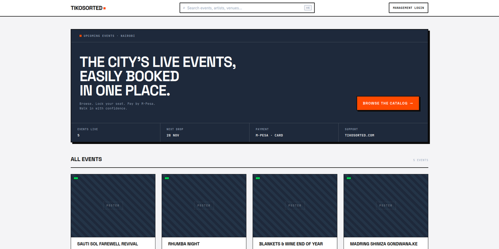
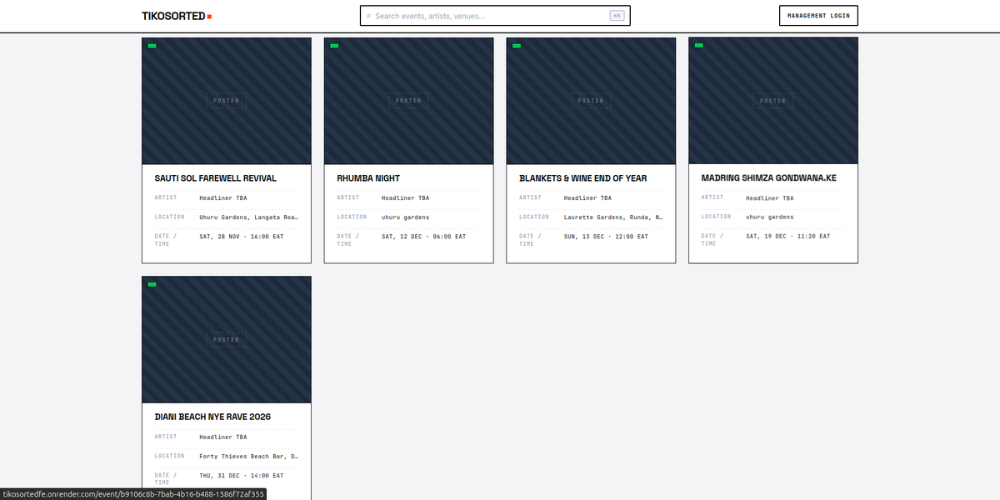
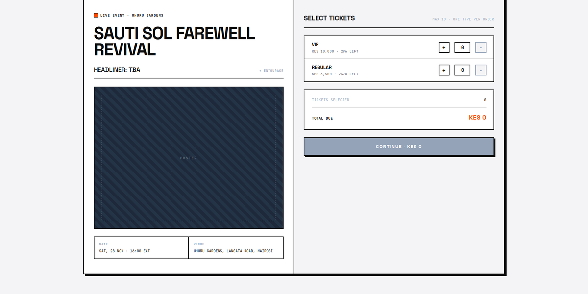
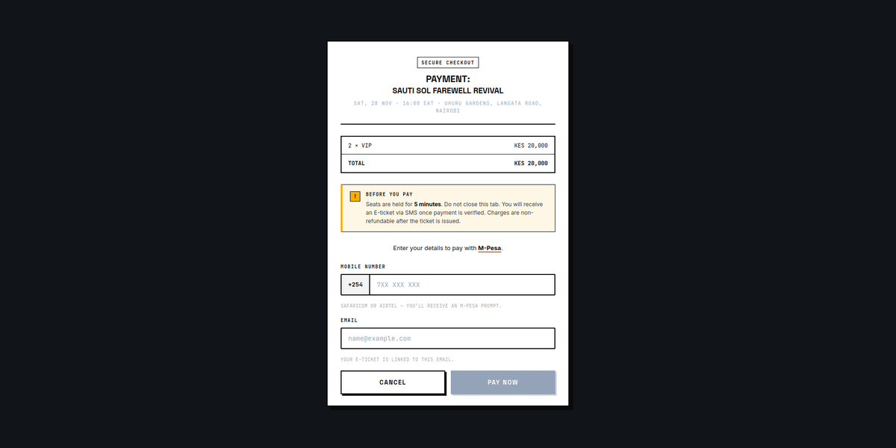
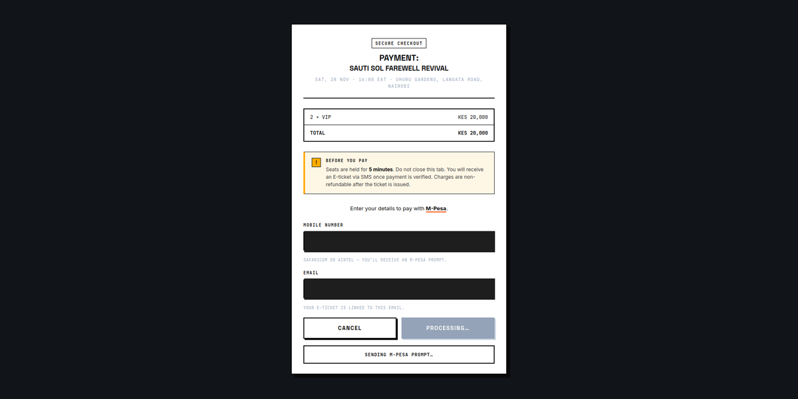
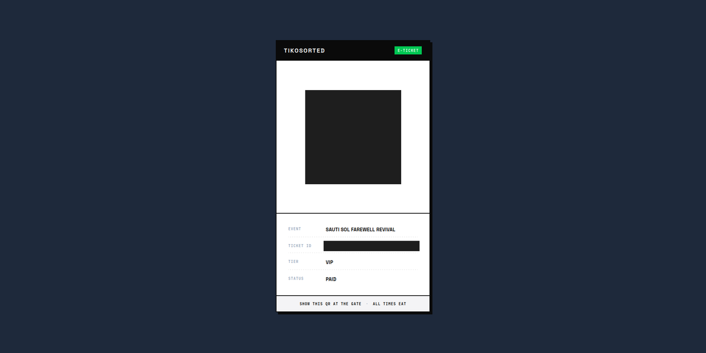
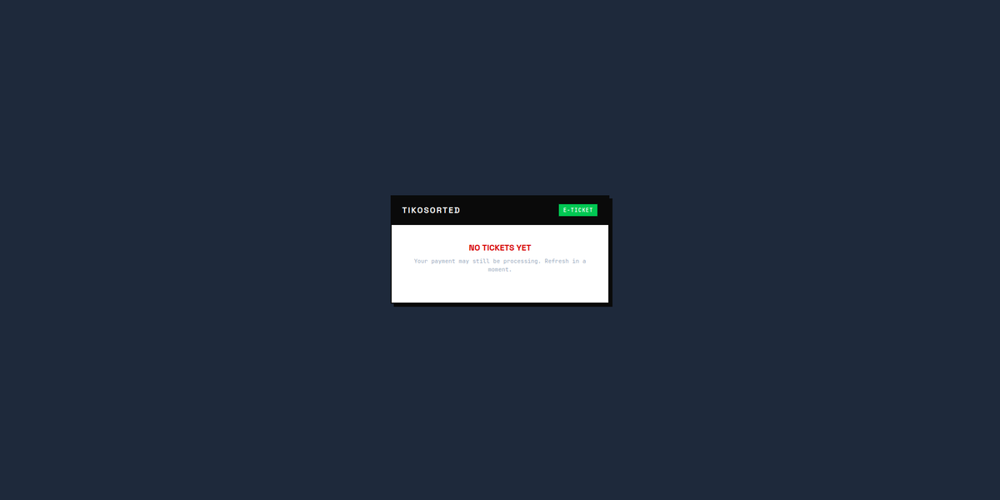

# Reveller Guide: Buying Tickets

You do not need an account. You need a phone with M-Pesa and an email address.

## 1. Find an event

Open https://tikosortedfe.onrender.com/. The home screen shows how many events are live and the date of the next one. Click **BROWSE THE CATALOG** to jump to the list.

Under **ALL EVENTS** each card shows the event name, artist, location, and date and time. Use the search box at the top to search by event name, venue, artist or status. Click a card to open the event.

Only events that are on sale, published or sold out appear.

> **Current limitation:** every event currently shows "Headliner TBA" and a grey poster box, because the headliner and poster entered by the organiser are not saved yet.

## 2. Choose your tickets

The event page shows the date and venue on the left. On the right, under **SELECT TICKETS**, each ticket type shows its price and how many are left.

1. Use **+** and **−** to pick a quantity.
2. You can buy up to **10 tickets** in one order, and only **one ticket type per order**. If you want VIP and Regular, make two orders.
3. Check **TICKETS SELECTED** and **TOTAL DUE**.
4. Click **CONTINUE**.

If the event is not on sale yet, the page says "Tickets are not on sale yet". If it is sold out, it says "This event is sold out."

## 3. Pay with M-Pesa

On **SECURE CHECKOUT** you see your order and the total.

1. Read the yellow **BEFORE YOU PAY** box. Your seats are held for a short time while you pay. The screen says 5 minutes. Do not close the tab. Charges cannot be refunded once the ticket is issued.
2. Type your **MOBILE NUMBER**. All of these work: `0712 345 678`, `712345678`, `254712345678`.
3. Type your **EMAIL**. Your tickets are sent here.
4. Click **PAY NOW**.

The screen then shows what is happening:

| Message | What it means | What you do |
|---|---|---|
| RESERVING SEATS… | Your seats are being held | Wait |
| SENDING M-PESA PROMPT… | A payment request is going to your phone | Wait |
| AWAITING PAYMENT… | Waiting for you to pay | Enter your M-Pesa PIN on your phone |
| PAID ✓ REDIRECTING… | Payment received | Wait, you go to your ticket |

> **Current limitation:** the checkout screen currently asks M-Pesa for KES 2 instead of the order total while the payment system is being tested. The ticket price shown on screen is still the real price. Do not use real money on the test site until this is fixed.

If you press **CANCEL**, you go back to the previous page.

## 4. Get your ticket

After payment you land on your **E-TICKET** page. It shows a QR code, the event name, the ticket ID, the ticket type and its status, **PAID**.

The ticket is also emailed to you with the QR codes attached, and the email has a link to the same page. Keep the link, or take a screenshot of the QR code.

If you see **NO TICKETS YET**, your payment may still be processing. Wait a moment and refresh the page.

> **Current limitation:** the checkout screen says you will get the ticket by SMS. At the moment tickets are sent by **email** only.

## 5. At the gate

1. Open your ticket on your phone, with the screen brightness turned up.
2. Show the QR code to the gate staff. They scan it and confirm your entry.
3. Each ticket works **once**. If someone else scans the same QR first, you will be refused, so do not share your ticket or post it online.

If you bought several tickets, each person needs their own QR code.

See [FAQ and troubleshooting](04-faq-and-glossary.md) if something goes wrong.
