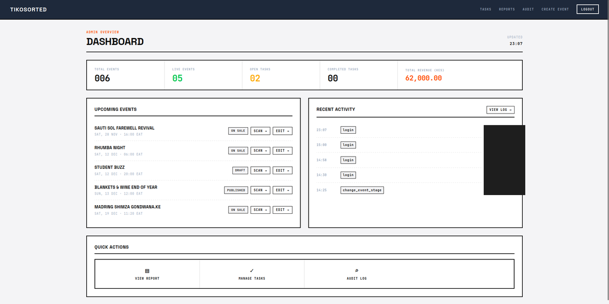
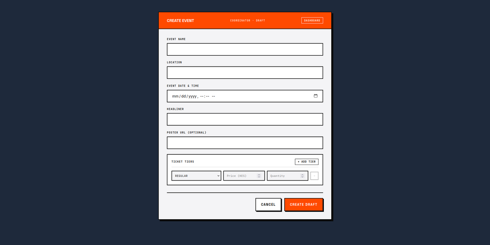
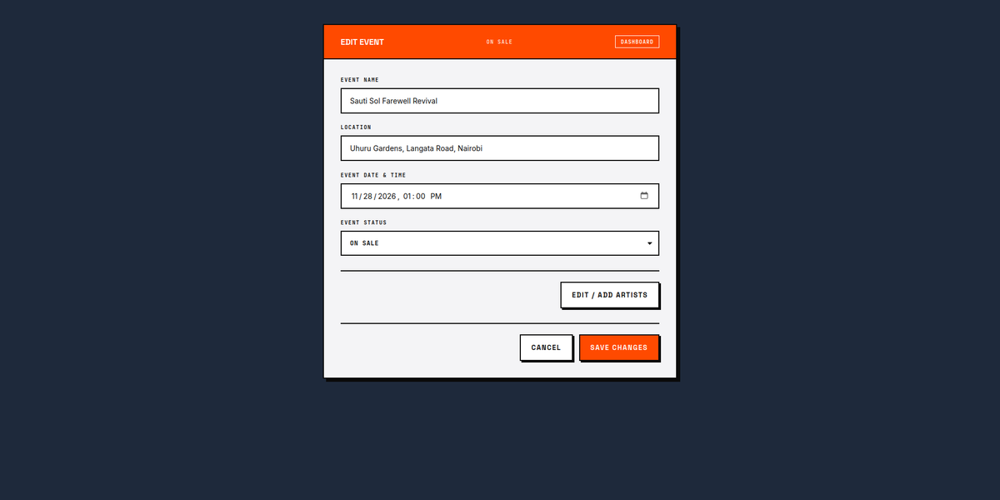
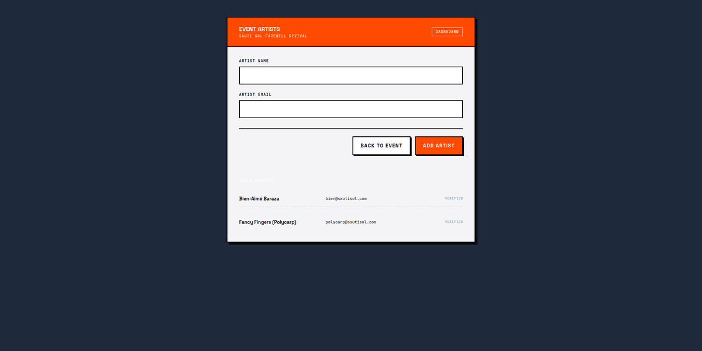
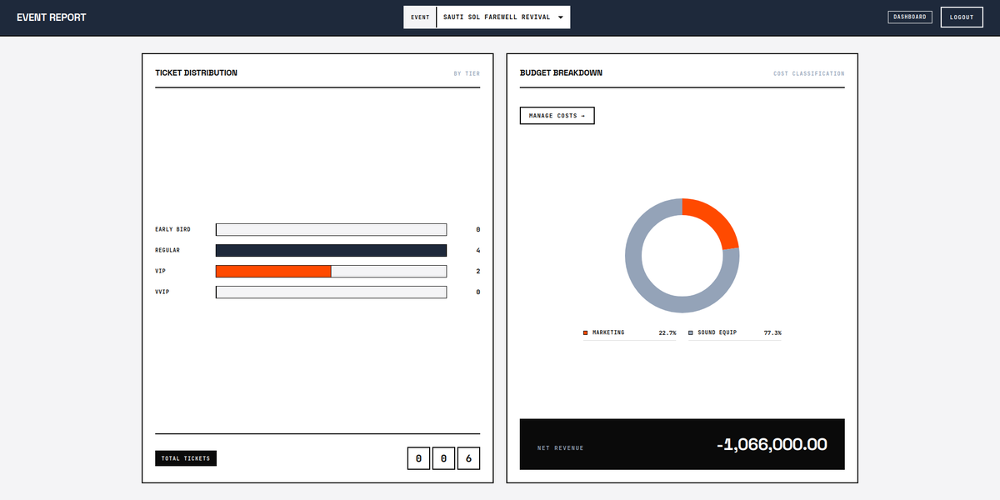
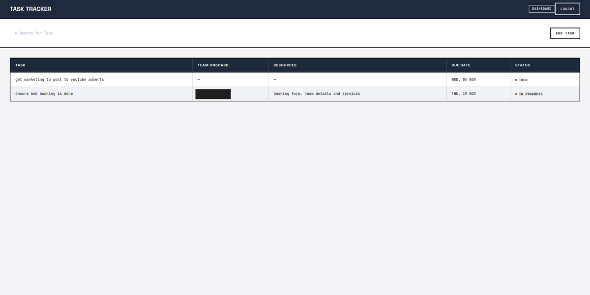
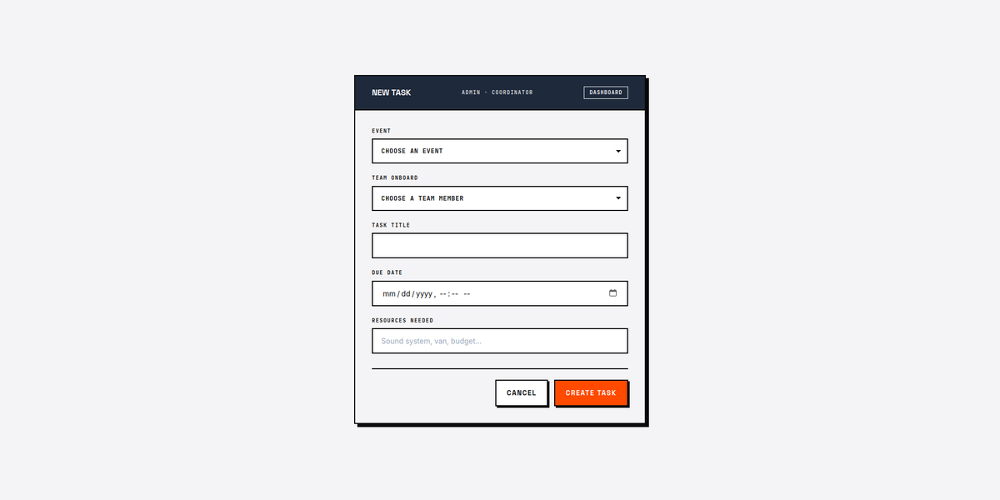
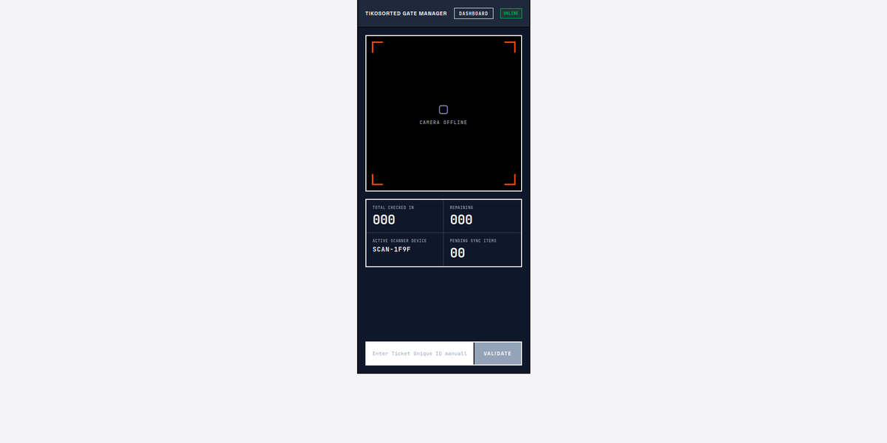

# Staff Guide

For management staff. Find your role below. Your role decides which screens work for you.

| Screen | Manager | Coordinator | Finance | Gate staff / Logistics | Compliance | Hospitality |
|---|---|---|---|---|---|---|
| Dashboard | yes | yes | yes | no | no | no |
| Create and edit events, change status | yes | yes | no | no | no | no |
| Add artists | yes | yes | no | no | no | no |
| View artists | yes | yes | no | no | no | yes |
| Event report | yes | yes | yes | no | no | no |
| Add and edit costs | yes | **no** | yes | no | no | no |
| View costs | yes | yes | yes | no | no | no |
| Tasks | yes | yes | yes | yes | yes | yes |
| Gate scanner | yes | no | no | yes | no | no |
| Audit log | yes | no | no | no | yes | no |

> **Current limitation:** the app shows every menu to every staff member. If you open a screen your role cannot use, it will show an empty page or a generic error. This is not your mistake. Use the table above.

## Logging in and out

1. On the public home page click **MANAGEMENT LOGIN** (top right).
2. Enter your work **Email** and **Password**, then click **LOGIN**.
3. You land on the dashboard. Click **LOGOUT** (top right) when you finish.

Good to know:
- Your session lasts up to **8 hours**.
- You can be signed in on **one device at a time**. Logging in on a second device signs the first one out.
- Closing the browser tab also signs you out.
- There is no "forgot password" screen yet. Ask a manager.
- Staff accounts are created by a manager through the technical team. There is no screen for it yet.

## The dashboard

Visible to manager, coordinator and finance.

- **Top bar:** TASKS, REPORTS, AUDIT, CREATE EVENT, LOGOUT.
- **Totals:** total events, live events, open tasks, completed tasks, and total revenue in KES from paid bookings.
- **Upcoming events:** the next five events with their status. **SCAN →** opens the gate scanner and **EDIT →** opens the event editor.
- **Recent activity:** the latest five actions by staff, such as logins and status changes. **VIEW LOG →** opens the full audit log.
- **Quick actions:** View report, Manage tasks, Audit log.

## Coordinator

### Create an event

1. On the dashboard click **CREATE EVENT**.
2. Fill in **EVENT NAME**, **LOCATION**, **EVENT DATE & TIME**, **HEADLINER** and optionally **POSTER URL**.
3. Under **TICKET TIERS** choose the type (Early bird, Regular, VIP or VVIP), set the **Price (KES)** and **Quantity**. Click **+ ADD TIER** for more types. Each type can be used once per event.
4. Click **CREATE DRAFT**. The event is saved as a **draft**, not visible to the public, and you go to the artist page.

Ticket tiers cannot be changed after the event is created, so check the prices and quantities first.

> **Current limitation:** the headliner and poster you enter are not saved yet, so the public pages show "Headliner TBA".

### Edit an event and change its status

1. On the dashboard click **EDIT →** next to the event.
2. Change **EVENT NAME**, **LOCATION** or **EVENT DATE & TIME**. These can only be changed while the event is a **draft** or **published**.
3. To move the event forward, pick the next step in **EVENT STATUS**.
4. Click **SAVE CHANGES**. **EDIT / ADD ARTISTS** opens the artist page.

> **Current limitation 1, the time shifts.** For events that are still a draft or published, the date and time box shows the time **3 hours earlier** than the real time (for example 1:00 PM for a 4:00 PM event), and **SAVE CHANGES** then moves the event 3 hours earlier each time. Always check the time on the public page after saving, and do not press **SAVE CHANGES** on a draft or published event unless you correct the time first.
>
> **Current limitation 2, no changes once on sale.** The screen saves the name, location and date first, and the system refuses that for an event that is already ON SALE or later. You will see a message such as "Request failed (409)" and the **status is not changed**. So today you can move an event from DRAFT to PUBLISHED and from PUBLISHED to ON SALE from this screen, but you cannot move it on to SOLD OUT, ONGOING, COMPLETED or CANCELLED. Ask the technical team to change those.

Status steps. You can only move along these arrows:

| From | You can move to |
|---|---|
| DRAFT | PUBLISHED, CANCELLED |
| PUBLISHED | ON SALE, CANCELLED |
| ON SALE | SOLD OUT, ONGOING, CANCELLED |
| SOLD OUT | ON SALE, ONGOING, CANCELLED |
| ONGOING | COMPLETED, CANCELLED |
| COMPLETED, CANCELLED | none, these are final |

Tickets can be bought **only while the event is ON SALE**. Move the event to ON SALE when you are ready to sell. Status is not changed automatically, so when tickets run out, set **SOLD OUT** yourself. Cancelling an event does not refund buyers or notify them. See the limitation above about changing status once an event is on sale.

### Add artists

1. Open **EVENT ARTISTS** (from the edit page, or straight after creating an event).
2. Enter **ARTIST NAME** and **ARTIST EMAIL**, then click **ADD ARTIST**.
3. The artist is emailed a link. The list shows each artist as **VERIFICATION PENDING** until they open it, then **VERIFIED**.

If the email cannot be sent, the artist is not added. An artist email can be added to an event only once.

### Tasks

See [Tasks](#tasks-all-staff) below. Coordinators can also open the **EVENT REPORT** (see Finance) but cannot add or edit costs.

## Finance

### Event report

1. Click **REPORTS** in the top bar.
2. Choose the event in the **EVENT** drop-down.
3. **TICKET DISTRIBUTION** shows paid tickets by tier and the total ticket count.
4. **BUDGET BREAKDOWN** shows how costs split across Marketing, Artists, Sound equipment and On ground.
5. **NET REVENUE** is the money from paid tickets minus all costs. It goes negative when costs are higher than sales.

### Add and edit costs

1. On the report page click **MANAGE COSTS →**.
2. Click **+ ADD COST**. Enter a name (for example "Stage lighting hire"), choose a **CLASSIFICATION** (MARKETING, ARTISTS, SOUND EQUIPMENT or ON GROUND), the amount in KES and the date. Click **ADD COST**.
3. To fix a mistake, click **EDIT** on the cost row, change it, and click **UPDATE COST**.

Only finance and managers can add or edit costs. Coordinators can see them but will get an error if they try to save.

Costs cannot be deleted from the app.

## Manager

Managers can use every screen above. In addition:

- **Audit log.** Click **AUDIT** in the top bar to see the record of staff actions: timestamp, actor, action, resource and details. Use the search box to filter by person or action. Typical actions are `login`, `create_event`, `update_event`, `change_event_stage`, `add_artist`, `create_task`, `add_cost`.
- **Staff accounts.** New staff are created by the technical team on a manager's request. Provide name, staff ID, work email and role.
- **Roles.** manager, coordinator, finance, logistics, production, marketing, hospitality, compliance, gate_staff. Production and marketing staff can currently only use Tasks.

## Tasks (all staff)

- **TASKS** in the top bar opens the **TASK TRACKER**: task, team member, resources, due date and status (TODO, IN PROGRESS, COMPLETED). Use the search box to filter.
- **ADD TASK** opens **NEW TASK**. Choose the event and the team member, enter the title, due date and resources needed, then click **CREATE TASK**.

- Click a task to open its details, edit it, or change its status.

> **Current limitation:** the "add note" box on a task does not save your note yet. Put important information in the title or the resources field.

## Gate staff and logistics

Use the scanner on a phone or tablet at the entrance. You need a `gate_staff` or `logistics` account (or a manager).

### Before the event

1. Log in and open the scanner. Managers and coordinators reach it with **SCAN →** on the dashboard. Gate staff use the link given by the coordinator, which ends in `/checkin/` and the event ID.
2. Allow camera access when the browser asks. Until then the box says **CAMERA OFFLINE**.
3. While you have internet the app downloads the list of paid tickets for the event and keeps a copy on the device. Open the page once with signal before you go to the venue.
4. The top right tag says **ONLINE** or **OFFLINE · SCANS WILL SYNC LATER**.

The panel shows **TOTAL CHECKED IN**, **REMAINING**, the **ACTIVE SCANNER DEVICE** name (a short code such as SCAN-1F9F) and **PENDING SYNC ITEMS**.

> **Current limitation:** if your account does not have the gate staff or logistics role, the counters stay at 000 because the ticket list cannot be downloaded.

### Checking someone in

1. Point the camera at the guest's QR code. If the camera is not working, type the ticket ID in **Enter Ticket Unique ID manually** and click **VALIDATE**.
2. If the ticket is good, the panel shows the ticket type, event name and price with **TICKET VALID — CONFIRM ENTRY**.
3. Let the guest in, then click **CONFIRM USED**. The message **ENTRY CONFIRMED: TICKET USED** appears and the counters update. Click **CANCEL** if the guest does not enter.
4. If the ticket is not good you see a red message such as **INVALID TICKET: ALREADY VERIFIED** or **INVALID TICKET: NOT IN MANIFEST**. Do not let the guest in. Send them to the help desk.

Tickets are only used when you press **CONFIRM USED**, so checking a ticket does not use it up.

### If the internet drops

The scanner keeps working from the saved list. Confirmed entries are saved on the device and counted under **PENDING SYNC ITEMS**. When the connection returns they upload automatically and the number goes back to 00. Keep the page open until it does, and do not clear the browser data in the meantime.

If two devices admit the same ticket while offline, the first upload to arrive is accepted and the other is recorded as a conflict in the system log. Nothing on screen shows conflicts yet, so tell the technical team if this happens.

An offline device cannot detect a forged QR code, only a ticket that is not on the list. Tickets are fully checked when the device syncs.
